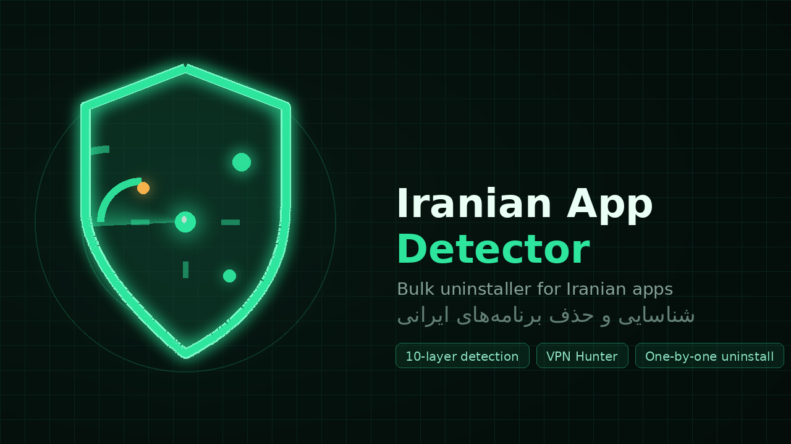

<div align="center">


# Iranian App Detector

**شناسایی و حذف برنامه‌های ایرانی — همراه با VPN Hunter**

Offline-first Android app that identifies apps published by Iranian companies,
explains *why* it thinks so, and helps you remove the ones you don't want — always
through the official Android confirmation dialog, one app at a time.

[](https://github.com/matrixteam403-hash/iranian-app-detector/actions/workflows/android-ci.yml)
[](LICENSE)
[](#)
[](#)
[](#testing)



</div>

---

## Table of contents

1. [What it does](#1-what-it-does)
2. [Detection engine](#2-detection-engine)
3. [VPN Hunter](#3-vpn-hunter)
4. [One-by-one uninstall flow](#4-one-by-one-uninstall-flow)
5. [Detection database](#5-detection-database)
6. [Building](#6-building)
7. [Signing](#7-signing)
8. [Permissions and their implications](#8-permissions-and-their-implications)
9. [Project layout](#9-project-layout)
10. [Testing](#10-testing)
11. [Brand assets](#11-brand-assets)
12. [Known limitations](#12-known-limitations)
13. [Privacy](#13-privacy)
14. [فارسی](#14-فارسی)

---

## 1. What it does

| Screen | Purpose |
|---|---|
| **Dashboard** | Installed / detected / verified / probable / uncertain counts, database info, scan button |
| **Scanner** | Live progress (packages discovered, package being analysed), cancellable |
| **Results** | Icons, names, developer, package id, confidence %, tier, per-app evidence, search, filters, sorting, select all, "Keep" (exclude) |
| **Uninstall queue** | Sequential system-confirmed uninstalls, live progress, removed/cancelled/failed counters, cancel remaining |
| **VPN Hunter** | Optional module: finds VPN / proxy / anti-censorship clients with five independent methods, each with its own **Remove** button |
| **Settings** | Appearance (3 themes), scan preferences, **VPN Hunter** (toggle + 2 filters), detection database, **uninstall safety** (pacing, help), **install aid**, privacy, about |

* 100 % Kotlin · Jetpack Compose · Material 3 · MVVM · Hilt · Room · Kotlinx Flow
* minSdk 26 · targetSdk/compileSdk 35, no analytics, no ads, no tracking, no root,
  no accessibility abuse, no device-admin tricks
* Works fully offline; every detection carries a human-readable "why"

## 2. Detection engine

Ten independent signals, each with an explicit explanation string and a point weight:

| Signal | Base points | Notes |
|---|---|---|
| Exact package id | 55–62 | Primary anchor |
| Historical / alternative package id | 50 | e.g. `cab.snapp.passenger.play` |
| Signing certificate (SHA-256 / SHA-1) | 60 | Capped at 72 without a package match |
| Shared signing key with another known app | 34 | Developer identity |
| English name / alias | 26 | Persian + Latin normalisation |
| Persian name / alias | 28 | ي/ی, ك/ک, diacritics, ZWNJ, Arabic-Indic digits |
| Fuzzy name (Levenshtein + containment) | 9–16 | ≥ 0.86 or containment |
| Package namespace of a known publisher | 18 | `com.digikala.foo` |
| Iranian installer (Bazaar, Myket, …) | 12 | Supporting only |
| Developer domain in package id | 10–12 | `digikala` → `digikala.com` |
| Icon perceptual hash (aHash, 64-bit) | 10–24 | Inert until verified reference hashes exist |

Calibration rules that keep the score honest:

* `ir.` prefix is **never** evidence (explicit test).
* Persian text alone is **never** evidence (explicit test).
* A single non-anchor signal can never exceed **29 %** → stays *Uncertain*.
* A certificate without a package match is capped at **72 %**.
* Overlapping name signals are damped when a package anchor already matched.
* Records marked `UNCERTAIN` in the database can never produce a *Verified* result.

Tiers: `Verified ≥ 80`, `Probable ≥ 55`, `Uncertain ≥ 30`; below that an app is not reported.

## 3. VPN Hunter

An **opt-in** module (Settings → *VPN Hunter*). Off by default; nothing is inspected
until you enable it and run a scan. It reports every installed package that looks like a
VPN, proxy or anti-censorship client, and it does so with **five independent methods**,
never a single heuristic:

| # | Method | What it inspects | Max points |
|---|---|---|---|
| 1 | **Known package** | Curated list of published VPN/proxy project ids (Psiphon, Outline, Shadowsocks, WireGuard, OpenVPN, v2rayNG, SagerNet/SFA, Husi, Happ, Amnezia, Tailscale, ZeroTier, WARP, Proton, Mullvad, NordVPN, Surfshark, ExpressVPN, Astrill, PIA, Windscribe, Orbot, I2P, Bitmask) plus vendor-prefix families | 62 |
| 2 | **VPN service declaration** | `android.permission.BIND_VPN_SERVICE`, `VpnService` subclasses in the manifest, transport cores (`xz`, wireguard, openvpn, shadowsocks, tun2socks…), captive-portal capture right | 45 |
| 3 | **System VPN accounting** | `NetworkInterface` for live `tun*/ppp*/utun*/wg*/ipsec*` devices + `ConnectivityManager` `TRANSPORT_VPN` + per-UID traffic from `TrafficStats` | 34 |
| 4 | **Routing profile** | Android's own *always-on VPN* setting (`always_on_vpn_app`, `_lockdown`), and "system VPN up while this app ships the transport" | 30 |
| 5 | **Name & developer** | Normalised label/package against VPN vocabulary (including فیلترشکن، پروکسی، تونل، اینترنت آزاد) and vendor names, plus tunnel deep links | 26 |

The curated list in v1.1 covers 60+ published clients, with Iran-focused projects called out
explicitly (Hiddify, NekoBox/NekoRay, v2rayNG, SagerNet/SFA, Husi, Happ, NapsternetV,
Lantern, Psiphon, Outline, Shadowsocks, WireGuard, OpenVPN, Amnezia, Shecan, Orbot, Plus the
commercial set). Families are matched by namespace, so `com.hiddify.*` is caught even when the
suffix is not in the list. A curated id alone scores 62 → **Likely**; **Confirmed** needs a
second independent method.

Scoring rules:

* Additive with diminishing returns: evidence past the two strongest items counts half.
* A **name-only** finding is capped at **40 %** — a name can hint, never confirm.
* Two agreeing methods get +6, three or more +4; total clamped to 100.
* Tiers: `Confirmed ≥ 70`, `Likely ≥ 45`, otherwise `Possible`.

Every finding shows the exact artefacts it was built from (permission name, service class,
native library, interface, traffic volume), and the report lists the platform limitations
it hit — for example *"Android does not expose the package that owns the system VPN"*.
Ownership of a live tunnel is only attributed when the package both declares
`BIND_VPN_SERVICE`/a VPN service **and** shows transport evidence; otherwise the interface
stays system-level context instead of being guessed onto an app.

**Remove per app (v1.1.1)** — every finding card has its own **Remove** button next to
*App info*. It removes that single client only: in-app confirmation → one system request →
`PackageManager` verification, then the finding disappears from the list. No queue has to be
built first, and the other apps on the device are untouched. A system/device-admin protected
client reports honestly instead of pretending it was removed; *App info* opens its Settings
page so you can still disable or force-stop it.

The engine (`vpn/VpnDetector.kt`) is pure Kotlin; all Android access lives in
`vpn/AndroidVpnProbe.kt` behind the `VpnProbe` interface, which is why the whole scoring
model is unit tested.

## 4. One-by-one uninstall flow

Reported bug: requests did not reach the phone one at a time, so the user could not accept
them individually. Three root causes were found and fixed:

1. **`collectLatest` cancellation.** `MainActivity` collected the UI event channel with
   `collectLatest`, so an incoming event cancelled the coroutine that was launching the
   *previous* system dialog. Now a plain `collect` with an explicit single-flight guard.
2. **Trusting `resultCode`.** Several OEM settings apps return `RESULT_CANCELED` even after
   a successful uninstall, which made the queue advance on wrong information. Success is now
   confirmed with `PackageManager` (re-checked at 250/400/600 ms after the dialog closes,
   plus `onResume`), and `RESULT_OK` is only a fast path.
3. **Lost results freezing the queue.** If the activity result was lost (process death,
   rotation, dialog dismissed by the system), `awaitingResult` stayed `true` forever. The
   state is now persisted in `onSaveInstanceState` / re-verified on resume, and
   `UNINSTALL_PACKAGE` is tried before the `DELETE` fallback.

Guarantees: exactly one dialog at a time, the next request is only issued after the previous
outcome is known, nothing is removed silently, and a stale second callback can never skip an
item (all covered by `UninstallRegressionTest`).

### 4.1 The in-app confirmation (v1.1)

On some OEM builds the system uninstall screen never appears at all — the queue used to end
with "Cancelled" and nothing happened. v1.1 therefore owns the confirmation itself:

1. The app shows **its own dialog for one app** ("Remove this app? 2 of 5") with the icon,
   label and package id, plus a short hold-to-confirm guard against double taps.
2. Only after that tap does it launch `ACTION_UNINSTALL_PACKAGE` (fallback
   `ACTION_DELETE`) with `EXTRA_RETURN_RESULT`.
3. If **no system UI was observed** (the activity never paused) and the package is still
   installed, the app opens that app's Settings page instead, where an Uninstall button
   always exists — and says so in the dialog.
4. The outcome is verified with `PackageManager` on a schedule the user can tune
   (Settings → *Uninstall safety* → *Pause between requests*, 150–1200 ms).
5. "Skip" marks one app cancelled **without** sending anything; "Cancel remaining" stops
   the queue.

An earlier bug is fixed as well: a late callback for an already-handled package can no
longer be attributed to the *next* app (`onUninstallResult` now carries the package name).

## 5. Detection database

* Bundled at `app/src/main/assets/detection_db.json` (18 records, 24 package ids,
  5 vendor-published certificates).
* Seeded into Room on first launch, cached in memory with prebuilt indexes
  (`package → record`, `certificate → record`, `domain → record`), so detection is O(1) per app.
* Optional remote update: put a URL in Settings → *Detection database*, then *Check for update*.
  The payload is validated (records with invalid package ids are dropped) **before** the table
  is replaced, so a bad payload can never wipe the bundled data.
* Adding an app = adding one JSON object. No code change, no new APK.

Every package id in the shipped database was verified against public sources. Certificate
fingerprints are included **only** where a vendor-attributable SHA-1 was published — the rest
are left empty rather than guessed.

## 6. Building

Requirements: **JDK 17**, Android SDK 35 (`platforms;android-35`, `build-tools;35.0.0`),
Gradle 8.7+.

```bash
echo "sdk.dir=/path/to/Android/Sdk" > local.properties

./gradlew :app:assembleDebug          # installable debug build
./gradlew :app:assembleRelease        # release build (R8 is opt-in: -PiranDetector.r8=true)
./gradlew :app:testDebugUnitTest      # 85 JVM unit tests, no emulator needed
```

The repository ships a `gradlew` shim instead of the binary wrapper jar. On a normal machine run
`gradle wrapper --gradle-version 8.7` once to generate the standard wrapper.

## 7. Signing

Release builds fall back to the **debug keystore** when `keystore.properties` is missing, so the
APK is immediately installable with `adb install -r`. For a real release key:

```properties
# keystore.properties (git-ignored)
storeFile=/absolute/path/to/release.jks
storePassword=…
keyAlias=…
keyPassword=…
```

CI release builds pick up `KEYSTORE_BASE64`, `KEYSTORE_PASSWORD`, `KEY_ALIAS` and `KEY_PASSWORD`
from repository secrets (see `.github/workflows/release.yml`). Never commit a keystore.

## 8. Permissions and their implications

| Permission | Why | Implication |
|---|---|---|
| `QUERY_ALL_PACKAGES` | Core function: inventory installed apps | Play requires a declared justification (app-management class). Without it, Android 11+ hides most packages |
| `REQUEST_DELETE_PACKAGES` | Lets the uninstall flow hand a package straight to the system uninstaller | Still always shows the system confirmation dialog; the app cannot remove anything silently |
| `INTERNET`, `ACCESS_NETWORK_STATE` | **Optional** database update; VPN Hunter reads the live network state | Only used for the GET you trigger yourself; no telemetry |

Not requested: `INSTALL_PACKAGES`, root, device admin, accessibility services, usage stats,
contacts, SMS, location. VPN Hunter reads only *public* package metadata (manifest
declarations, native library names, traffic counters) — never traffic content.

## 8.1 "The browser offers Termux instead of Package installer"

This is the second reported issue, and it is a platform rule rather than an app bug:
a browser can only hand an APK to the package installer when **"Install unknown apps"** is
allowed for that browser. If it is not, Android shows whatever it thinks can open
`application/vnd.android.package-archive` — often a terminal or a file manager.

What v1.1 does about it:

* The manifest now declares `<queries>` for `INSTALL_PACKAGE`, `CONFIRM_INSTALL`, the
  `application/vnd.android.package-archive` MIME type and `MANAGE_UNKNOWN_APP_SOURCES`, so
  intent resolution works on Android 11+ (this was missing before and also affected the
  uninstall actions — see §4).
* Settings → *Install aid* (and the `?` icon on the Results screen) explains the rule and
  opens **`ACTION_MANAGE_UNKNOWN_APP_SOURCES`** for this app and the Downloads screen
  directly instead of describing menus.
* If you already downloaded an APK, the same dialog can hand that exact file to the
  platform installer.

The app never requests `INSTALL_PACKAGES` and never installs anything itself — Android only
grants that permission to system apps.

## 9. Project layout

```
app/src/main/kotlin/ir/irandetector/app/
├── core/          Json (hand-rolled), TextNormalizer (Persian-aware), PackageNames
├── data/          KnownApp, DetectionRepository, ScanRepository, RemoteDatabaseClient
├── database/      Room entities, DAOs, AppDatabase
├── detection/     DetectionEngine + DetectionIndex + IconHash (pure Kotlin)
├── domain/        InstalledApp, DetectionResult, signals, tiers, progress, stats
├── scanner/       PackageScanner (PackageManager only), IconHasher
├── uninstall/     UninstallManager sequential queue state machine (pure Kotlin)
├── vpn/           VpnDetector + VpnSignatures (pure) · AndroidVpnProbe (platform)
├── presentation/  AppViewModel — single source of truth
├── settings/      DataStore preferences
└── ui/            theme, components, AppIcon, Navigation, screens/
```

## 10. Testing

`./gradlew :app:testDebugUnitTest` → **93 tests, 0 failures** (plain JVM, no emulator):

| Suite | Tests | Covers |
|---|---|---|
| `DetectionEngineTest` | 18 | Package/cert anchors, capping, Persian-name-only, `ir.` rejection, fuzzy & namespace matches, score ceiling, explanation integrity |
| `TextNormalizerTest` | 17 | Arabic→Persian folding, diacritics, ZWNJ, digits, Levenshtein, package-id validation |
| `UninstallManagerTest` | 13 | Double-launch prevention, cancel vs failure, completion, stale results, progress monotonicity |
| `VpnDetectorTest` | 21 | All five methods, name-only cap, multi-method bonus, always-on routing evidence, bounds/sorting, dedupe, signature-DB integrity |
| `UninstallRegressionTest` | 9 | The reported one-by-one bug: order, cancelled results, lost results, stuck flags, duplicate callbacks, explicit skip, single-item removal (VPN Hunter path) |
| `DatabaseRecordTest` | 8 | Record parsing, invalid-id rejection, entity round-trip, marketplaces |
| `IconHashTest` | 7 | aHash determinism, distance, malformed hashes, "icon alone" band |

## 11. Brand assets

| File | What |
|---|---|
| `brand/logo.svg` | Master logo, vector source (shield + radar) |
| `brand/logo-512.png`, `brand/logo-1024.png` | Raster exports (GitHub avatar / README) |
| `brand/motion-logo.mp4` | 7 s, 1280×720, 30 fps logo reveal (H.264) |
| `brand/motion-logo.gif` | Same animation as a README-friendly GIF |
| `brand/motion-poster.png` | Poster / thumbnail frame |
| `brand/render_motion.py` | The renderer itself — the animation is code, fully reproducible (`python3 brand/render_motion.py`, needs Pillow + ffmpeg) |

<div align="center"></div>

The launcher icon (`app/src/main/res/drawable/ic_launcher_foreground.xml`) is the same shield
glyph as adaptive vector art, with a monochrome layer for Android 13+ themed icons — no PNG
density buckets, so it stays a few hundred bytes.

## 12. Known limitations

1. Detection is **probabilistic**. The shipped database is deliberately conservative: it will
   miss Iranian apps that are not in it, and absence from the database is *not* evidence of safety.
2. No certificate fingerprints are shipped for most records because none could be verified from a
   vendor-attributable source.
3. Icon hashing is implemented and tested but inert until verified reference hashes exist —
   inventing them is not an option.
4. Only `QUERY_ALL_PACKAGES`-visible packages can be scanned; restricted OEM builds report fewer
   packages and the app says so instead of guessing.
5. Android does not reveal which package owns the system VPN. VPN Hunter infers ownership only
   from declarations + transport evidence, and labels weak matches `Possible`.
6. `TrafficStats` counters are unavailable for other UIDs on some ROMs; the method then simply
   contributes nothing (no penalty, no fabrication).
7. The app never removes anything silently: both our own dialog and the system one can be
   declined, and a declined app stays installed. If an OEM build suppresses the system
   uninstall screen entirely, the app falls back to that app's Settings page and tells you.
8. Runtime behaviour was validated by unit tests and static analysis; this project is built and
   tested in an environment without an emulator, so please report device-specific issues.
9. There is no server for database updates — the URL is user-supplied by design.
10. The UI is English-only, though the framework RTL support is enabled.

## 13. Privacy

No analytics, no crash reporting SDK, no advertising id, no account. The installed-app list never
leaves the device. Scans live in a local Room database you can clear at any time. The only network
request is the database update you configure yourself. See `SECURITY.md`.

## 14. فارسی

**Iranian App Detector** یک اپلیکیشن اندروید کاملاً آفلاین است که برنامه‌های منتشرشده توسط
شرکت‌های ایرانی را شناسایی می‌کند، **دلیل** هر شناسایی را نشان می‌دهد و به شما کمک می‌کند
برنامه‌های ناخواسته را حذف کنید — همیشه از طریق پنجرهٔ رسمی تأیید اندروید.

* **۱۰ لایهٔ تشخیص** با امتیازدهی شفاف؛ هر شناسایی همراه با شواهد قابل بررسی نمایش داده می‌شود.
  هیچ داده‌ای ساختگی نیست: شناسهٔ بسته و اثر انگشت گواهی فقط از منابع عمومی تأییدشده آمده است.
* **VPN Hunter** (به‌صورت پیش‌فرض خاموش است): با فعال‌کردن آن در تنظیمات، همهٔ برنامه‌های
  VPN/فیلترشکن روی گوشی با **پنج روش مستقل** پیدا می‌شوند و هر کارت دکمهٔ **Remove** جداگانه
  دارد؛ یعنی می‌توانید هر VPN را تک‌تک و مستقل از بقیه حذف کنید: شناسهٔ بستهٔ شناخته‌شده،
  اعلان سرویس VPN و مجوز `BIND_VPN_SERVICE`، شمارندهٔ ترافیک و رابط‌های `tun/ppp/utun`،
  پروفایل مسیریابی و تنظیم «VPN همیشه روشن» اندروید، و نام/توسعه‌دهنده.
  نتیجهٔ فقط بر اساس نام، حداکثر ۴۰٪ اعتماد می‌گیرد.
* **حذف یکی‌یکی (اصلاح‌شده در ۱.۱)**: حالا خودِ برنامه برای هر اپ یک پنجرهٔ تأیید نشان می‌دهد
  («حذف این برنامه؟ ۲ از ۵»)، و فقط بعد از تأیید شما درخواست را به اندروید می‌فرستد. اگر
  گوشی شما پنجرهٔ سیستم را نشان نداد، برنامه به‌جای تمام‌کردن صف، صفحهٔ تنظیمات همان اپ را
  باز می‌کند که همیشه دکمهٔ Uninstall دارد. موفقیت با `PackageManager` بررسی می‌شود، نه با
  کد پاسخ. فاصلهٔ زمانی بین درخواست‌ها در تنظیمات قابل تنظیم است.
* **مشکل «Package installer پیشنهاد نمی‌شود»**: این محدودیت اندروید است — مرورگر فقط وقتی
  می‌تواند APK را به نصب‌کننده بدهد که «نصب برنامه‌های ناشناس» برای همان مرورگر فعال باشد.
  در تنظیمات → *Install aid* (و آیکون «؟» در صفحهٔ نتایج) هر دو صفحهٔ تنظیمات لازم با یک
  ضربه باز می‌شود و توضیح داده شده است.
* بدون تبلیغات، بدون ردیابی، بدون نیاز به روت. تنها درخواست شبکه‌ای، به‌روزرسانی پایگاه‌داده
  است که آدرسش را خودتان وارد می‌کنید.

---

<div align="center">
<sub>MIT licensed · built with Kotlin, Compose and a healthy distrust of heuristics</sub>
</div>
